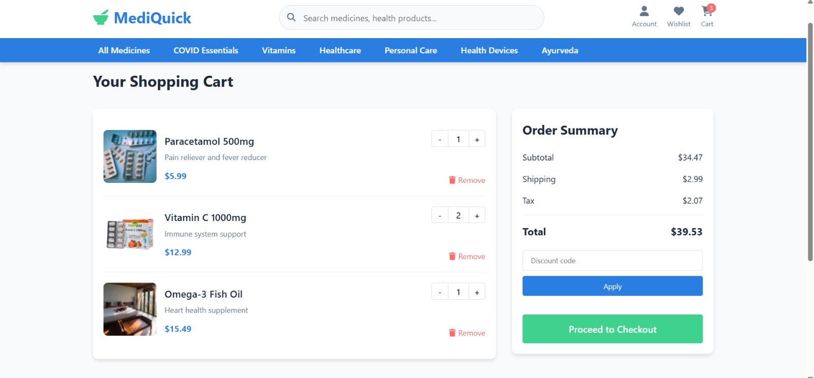
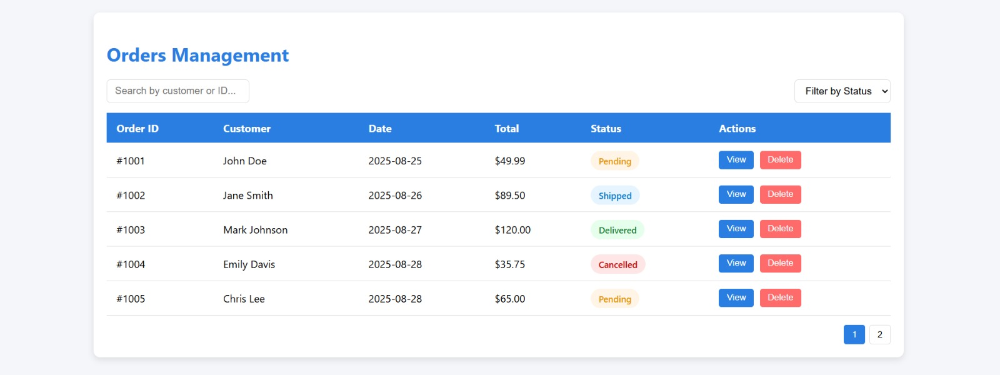

# Online Medicine Ordering System
A full-stack web application developed as a **2nd-year, 1st-semester group project** using **Java Servlets** and **MySQL**. The system enables patients to purchase prescription and non-prescription medicines online, with secure workflows for pharmacists, delivery managers, support agents and administrators.

## Features

### Patients
- Browse non prescription medicines and view prices
- Upload prescriptions for pharmacist validation
- Manage cart, enter delivery details  and make secure payments
- Track orders and receive invoices

### Pharmacists
- Review uploaded prescriptions
- Validate stock availability
- Enter medicine details, usage instructions and create orders
- Update inventory and prescription status

### Delivery Managers
- Cross-check orders with pharmacist-prepared packages
- Create delivery notes and print shipping labels
- Contact users for incomplete delivery details
- Track packages and update delivery status

### Support Agents
- Manage support tickets and respond to user queries
- Contact users for clarification
- Update or remove registered user accounts

### Administrators
- Manage pharmacists, delivery managers, support agents and other admins
- Oversee medicine catalog (add/update/remove items)
- Generate sales, inventory and user reports

## Tech Stack
- **Frontend:** JSP, HTML, CSS, JavaScript  
- **Backend:** Java Servlets, JDBC  
- **Database:** MySQL (normalized schema with CRUD operations)  
- **Architecture:** MVC pattern with role-based access control  

##  Key Highlights
- Role-based redirection system for **Patients, Pharmacists, Delivery Managers, Support Agents, and Admins**
- Secure login with input validation
- Prescription upload and pharmacist workflow automation
- Delivery tracking with escalation for delays
- Support ticket management with follow-up handling

## Screenshots 

### Home Page

### Order Summary Page

### Order Manager

## Team Members
- **IT22140616** – R. M. S. D. Rathnayake  
- **IT22177414** – R. U. Fernando  
- **IT22128522** – D. K. S. D. Perera  
- **IT22179258** – S. N. Palliyaguruge 